# Thindesk · Dashboard Administrativo de Chamados

**Documentação do projeto** · Aplicativos Web · Bacharelado em Sistemas de Informação · UMC
**Autor:** João Pedro Rachid de Abreu (RGM 11231102470) · **Professor:** Alessandro Aparecido · **Versão:** 1.0.0 · **Repositório:** https://github.com/Rachid0607/thindesk-dashboard

---

## Sumário

1. [Introdução e objetivo](#1-introdução-e-objetivo)
2. [Contexto: as duas bases do projeto](#2-contexto-as-duas-bases-do-projeto)
3. [Requisitos funcionais](#3-requisitos-funcionais)
4. [Requisitos não funcionais](#4-requisitos-não-funcionais)
5. [Regras de negócio](#5-regras-de-negócio)
6. [Modelagem](#6-modelagem)
7. [Arquitetura](#7-arquitetura)
8. [Documentação da API](#8-documentação-da-api)
9. [Dashboard administrativo](#9-dashboard-administrativo)
10. [Evidências de testes](#10-evidências-de-testes)
11. [Principais decisões de projeto](#11-principais-decisões-de-projeto)
12. [Gitflow e organização do repositório](#12-gitflow-e-organização-do-repositório)
13. [Como executar](#13-como-executar)

---

## 1. Introdução e objetivo

O **Thindesk** é um sistema de chamados técnicos (help desk). Esta entrega adiciona a ele um **Dashboard Administrativo** que permite ao responsável pelos chamados acompanhar o andamento da operação de suporte. Com ele dá para ver a situação dos chamados, o cumprimento de prazos, os tipos de problema mais frequentes e o desempenho dos técnicos, informações que apoiam a tomada de decisão.

O dashboard não acessa o banco diretamente. Todos os dados vêm de uma **API REST** que também foi projetada e implementada neste trabalho e que fica integrada ao banco de dados MongoDB.

**Objetivo da atividade:** analisar os requisitos, projetar e implementar o painel administrativo, aplicando análise e projeto de software, modelagem de dados, desenvolvimento de APIs e integração entre sistemas.

## 2. Contexto: as duas bases do projeto

O projeto foi construído sobre dois códigos que já existiam:

| Base | O que foi aproveitado |
|---|---|
| **Thindesk original** (Spring Boot 3.4 + Bootstrap + MongoDB) | Domínio de chamados, **clientes** (nome, telefone, setor) e **horários de atendimento** por setor; nomes das coleções (`chamados`, `clientes`, `horariosAtendimento`); identidade visual (logo *Thindesk Service Manager*, laranja da marca e menu lateral escuro com as seções de operação e configurações). |
| **login-seguro-spring** (meu projeto da disciplina de Aplicativos Web) | Autenticação com Spring Security e BCrypt, bloqueio por tentativas, sessão persistida no MongoDB, perfis de acesso, auditoria e alternância de tema claro/escuro. |

O Thindesk original guardava o chamado com campos de texto livre (`descricao`, `status`, `tipo`, `tecnico`, `usuario`) e usava um único usuário fixo no `application.properties`. Para o dashboard conseguir calcular indicadores confiáveis, o chamado passou a ter **status, tipo e prioridade controlados** (enumerações), **datas do ciclo de vida** (abertura, início do atendimento, resolução e fechamento), **prazo de SLA**, **considerações técnicas** e **histórico de status**. O login virou multiusuário, com os perfis ADMINISTRADOR, TÉCNICO e SOLICITANTE.

## 3. Requisitos funcionais

| ID | Requisito | Descrição | Critérios de aceite | Onde está |
|---|---|---|---|---|
| **RF01** | Indicadores gerais de chamados técnicos | Exibir os números principais do período filtrado. | Mostra total, em aberto (na fila, em atendimento, aguardando), atendidos, atrasados, % resolvidos no prazo, tempo médio do 1º atendimento, tempo médio de resolução, taxa de resolução, variação em relação ao período anterior e chamados abertos fora do expediente. | `GET /api/v1/dashboard/indicadores` · cartões no topo do dashboard |
| **RF02** | Análise de chamados atendidos por período (gráficos) | Gráfico com a evolução de abertos x resolvidos. | Agrupa por dia, semana ou mês, no fuso de São Paulo. Períodos sem chamados aparecem com zero. Tooltip ao passar o mouse. | `GET /api/v1/dashboard/atendimentos-por-periodo` · gráfico de linhas |
| **RF03** | Situação dos chamados | Distribuição dos chamados por status e por prioridade. | Lista todos os 6 status e as 4 prioridades, com quantidade e percentual, inclusive os que estão em zero. | `GET /api/v1/dashboard/situacao` · gráfico de barras + barras de prioridade |
| **RF04** | Tipos de chamados mais atendidos | Ranking dos tipos com mais chamados resolvidos ou fechados. | Ordena por atendidos (desempate por total). Mostra percentual dos atendidos e tempo médio de resolução. Limite configurável (1 a 8). | `GET /api/v1/dashboard/tipos-mais-atendidos` · gráfico de barras horizontais (+ ranking de técnicos) |
| **RF05** | Filtros de consulta | Filtrar todas as informações do painel. | Período (com atalhos de hoje, 7 dias, 30 dias, 90 dias e 12 meses), tipo, status, prioridade, técnico e setor. Os filtros ficam na URL, então a visão pode ser recarregada e compartilhada. Período inválido é avisado antes de consultar a API. | Parâmetros de consulta comuns a todos os endpoints · `GET /api/v1/filtros/opcoes` |
| **RF06** | Integração com a API | O painel obtém todos os dados pela API REST. | A página só entrega o esqueleto e o JavaScript chama a API com a sessão do usuário logado e o token CSRF. A API também pode ser usada por outros sistemas com HTTP Basic. | `static/js/dashboard.js` · `/api/v1/**` |
| **RF07** | Atualização e tratamento de dados | Manter os dados atualizados e tratados para exibição. | Botão "Atualizar" e atualização automática a cada 60 s (preferência lembrada no navegador). Horário da última atualização na tela. Estados de carregando, vazio e erro **por bloco** (uma falha não derruba o painel). Datas, números, percentuais e horas formatados em pt-BR, datas convertidas do UTC para o fuso de São Paulo e nulos exibidos como "—". | `static/js/dashboard.js` · DTOs da API |

**Requisitos complementares** (necessários para os dados existirem e virem do Thindesk):

| ID | Requisito |
|---|---|
| RC01 | Abrir chamado (inclusive em nome de um cliente cadastrado, herdando o setor dele). |
| RC02 | Mudar o status do chamado respeitando o ciclo de vida e registrar considerações técnicas. |
| RC03 | Listar e detalhar chamados com paginação, busca e ordenação. |
| RC04 | Cadastrar e listar clientes (tela e API). |
| RC05 | Configurar o horário de atendimento de cada setor (tela e API). |
| RC06 | Controle de acesso por perfil: o dashboard é exclusivo do ADMINISTRADOR. |

## 4. Requisitos não funcionais

| ID | Categoria | Requisito | Como foi atendido |
|---|---|---|---|
| RNF01 | Segurança | Somente usuários autenticados acessam a API; o dashboard é exclusivo do perfil ADMINISTRADOR. | Cadeia própria do Spring Security para `/api/**`, autorização por perfil, senhas com BCrypt (custo 12) e bloqueio após 5 tentativas em 15 min. |
| RNF02 | Segurança | Proteção contra CSRF nas operações de escrita feitas pelo navegador. | Token CSRF enviado no header `X-CSRF-TOKEN`. Chamadas com header `Authorization` (HTTP Basic) não usam cookie e ficam fora da checagem. |
| RNF03 | Segurança | Erros não podem expor detalhes internos. | Erros 500 retornam mensagem genérica; o stack trace fica só no log do servidor. |
| RNF04 | Desempenho | Os indicadores devem ser calculados sem carregar todos os chamados na aplicação. | Pipelines de agregação no MongoDB (`$match`, `$group`, `$facet`, `$dateTrunc`) e índices em `status`, `tipo`, `dataAbertura`, `setor`, `tecnico.usuarioId` e `(status, dataAbertura)`. |
| RNF05 | Desempenho | A listagem deve ser paginada. | `page`/`size` com no máximo 100 itens por página. |
| RNF06 | Interoperabilidade | API REST versionada, em JSON e com erros padronizados. | Prefixo `/api/v1`, DTOs próprios (a entidade nunca é exposta) e erros no formato Problem Details (RFC 9457, `application/problem+json`). |
| RNF07 | Usabilidade | Painel legível e consistente. | Rótulos em português, datas em pt-BR, cores com contraste nos dois temas e par azul/laranja distinguível por daltônicos nos gráficos. |
| RNF08 | Responsividade | Funcionar em telas menores. | Grade em CSS que vira uma coluna abaixo de 860 px; menu lateral vira barra superior. |
| RNF09 | Disponibilidade / tolerância a falhas | Falha em um endpoint não pode derrubar o painel. | Cada bloco carrega de forma independente (`Promise.allSettled`) e oferece "Tentar de novo". |
| RNF10 | Manutenibilidade | Código organizado e testado. | Pacotes por assunto, services com regras de negócio, 95 testes automatizados e relatório de cobertura (JaCoCo). |
| RNF11 | Portabilidade | Rodar em qualquer máquina com Java 21. | Maven Wrapper, configuração por variáveis de ambiente (`.env`) e Chart.js servido localmente (sem CDN). |
| RNF12 | Privacidade (LGPD) | Coletar o mínimo de dados pessoais. | O chamado guarda só id e nome do solicitante e do técnico; a auditoria nunca grava senha nem e-mail digitado em tentativa de login. |

## 5. Regras de negócio

### 5.1 Prioridade e SLA

O prazo (SLA) é a data de abertura mais as horas da prioridade:

| Prioridade | SLA |
|---|---|
| Baixa | 72 h |
| Média | 48 h |
| Alta | 24 h |
| Crítica | 8 h |

Um chamado é **atrasado** quando: (a) foi resolvido depois do prazo; ou (b) ainda não foi resolvido, não foi cancelado e o prazo já passou. Chamados cancelados nunca contam como atrasados.

### 5.2 Ciclo de vida (máquina de estados)

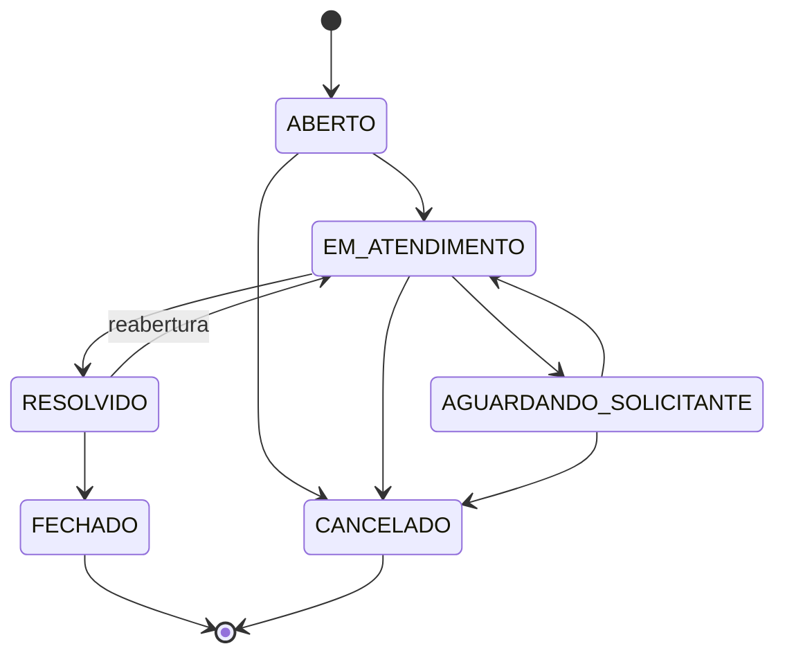

- Qualquer outra transição é recusada com **HTTP 409**, informando os destinos permitidos.
- Ao entrar em atendimento, o chamado precisa de um técnico: o informado em `tecnicoId` (precisa ser um usuário TÉCNICO ativo) ou, se o próprio usuário for técnico, ele mesmo.
- As datas são preenchidas automaticamente: início do atendimento (só na primeira vez), resolução (ao resolver; é limpa na reabertura) e fechamento (ao fechar ou cancelar).
- Toda mudança vai para o histórico do chamado e para a auditoria. Um comentário enviado junto vira consideração técnica.
- Chamados fechados ou cancelados não aceitam novas considerações.

### 5.3 Fórmulas dos indicadores (RF01)

| Indicador | Fórmula |
|---|---|
| Total | chamados abertos no período e que atendem aos filtros |
| Em aberto | ABERTO + EM_ATENDIMENTO + AGUARDANDO_SOLICITANTE |
| Atendidos | RESOLVIDO + FECHADO |
| Atrasados | regra da seção 5.1 |
| % resolvidos no prazo | atendidos com `dataResolucao ≤ prazoSla` ÷ atendidos × 100 |
| Tempo médio do 1º atendimento | média de `dataInicioAtendimento − dataAbertura` |
| Tempo médio de resolução | média de `dataResolucao − dataAbertura` dos atendidos |
| Taxa de resolução | atendidos ÷ (total − cancelados) × 100 |
| Variação | (total − total do período anterior de mesmo tamanho) ÷ total anterior × 100 |
| Abertos fora do expediente | chamados cuja abertura (em São Paulo) cai fora do horário de atendimento cadastrado para o setor. Setor sem horário cadastrado não tem restrição. |

Percentuais e médias sem base de cálculo (divisão por zero) voltam como `null` e aparecem como "—" no painel.

### 5.4 Filtros

- `inicio` e `fim` são dias inteiros no fuso **America/Sao_Paulo** (o banco grava em UTC).
- Sem datas, o dashboard usa os **últimos 30 dias**. Com só uma das datas, completa a outra com uma janela de 30 dias.
- `inicio` não pode ser depois de `fim`, e o período máximo é de **366 dias** (HTTP 400).
- `tipo`, `status` e `prioridade` aceitam vários valores separados por vírgula.

### 5.5 Perfis de acesso

| Recurso | ADMINISTRADOR | TÉCNICO | SOLICITANTE |
|---|---|---|---|
| Dashboard e `/api/v1/dashboard/**`, `/api/v1/filtros/**` | ✔ | ✖ (403) | ✖ (403) |
| Horários de atendimento (tela e API) | ✔ | ✖ | ✖ |
| Clientes (tela e API) | ✔ | ✔ | ✖ |
| Listar e detalhar chamados | todos | todos | só os próprios |
| Abrir chamado | ✔ (pode usar `clienteId`) | ✔ (pode usar `clienteId`) | ✔ (só em nome próprio) |
| Mudar status e registrar consideração | ✔ | ✔ | ✖ |

## 6. Modelagem

### 6.1 Diagrama de classes do domínio

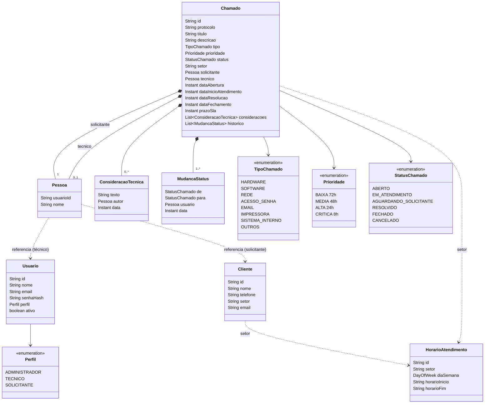

### 6.2 Coleções no MongoDB

| Coleção | Origem | Conteúdo | Índices |
|---|---|---|---|
| `chamados` | Thindesk (evoluída) | documento do chamado com solicitante, técnico, considerações e histórico **embutidos** | `protocolo` (único), `status`, `tipo`, `setor`, `dataAbertura`, `tecnico.usuarioId`, `solicitante.usuarioId`, `(status, dataAbertura)` |
| `clientes` | Thindesk | nome, telefone, setor, e-mail | `nome`, `setor` |
| `horariosAtendimento` | Thindesk | setor, dia da semana, início e fim (`HH:mm`) | `(setor, diaSemana)` único |
| `usuarios` | login-seguro | usuários com perfil e senha BCrypt | `email` (único) |
| `contadores` | novo | sequência anual do protocolo (`TD-AAAA-000123`) | `_id` |
| `auditoria` | login-seguro | eventos de login, perfil, abertura e mudança de status | — |
| `sessoes`, `tentativas_login` | login-seguro | sessão HTTP e controle de força bruta (com TTL) | TTL |

Exemplo de documento da coleção `chamados`:

```json
{
  "_id": "6735f2a1c0ffee0012ab34cd",
  "protocolo": "TD-2026-000381",
  "titulo": "Atualização do navegador",
  "descricao": "Chamado aberto por Camila Rocha: atualização do navegador.",
  "tipo": "SOFTWARE",
  "prioridade": "BAIXA",
  "status": "FECHADO",
  "setor": "Comercial",
  "solicitante": { "usuarioId": "6735f29fc0ffee0012ab3001", "nome": "Camila Rocha" },
  "tecnico": { "usuarioId": "6735f29ec0ffee0012ab2001", "nome": "Rafael Souza" },
  "dataAbertura": { "$date": "2026-11-13T18:51:00Z" },
  "dataInicioAtendimento": { "$date": "2026-11-13T20:02:00Z" },
  "dataResolucao": { "$date": "2026-11-14T09:40:00Z" },
  "dataFechamento": { "$date": "2026-11-14T13:12:00Z" },
  "prazoSla": { "$date": "2026-11-16T18:51:00Z" },
  "consideracoes": [
    { "texto": "Aplicada a atualização mais recente do fornecedor.", "autor": { "usuarioId": "…", "nome": "Rafael Souza" }, "data": { "$date": "2026-11-14T09:40:00Z" } }
  ],
  "historico": [
    { "de": null, "para": "ABERTO", "usuario": { "nome": "Camila Rocha" }, "data": { "$date": "2026-11-13T18:51:00Z" } },
    { "de": "ABERTO", "para": "EM_ATENDIMENTO", "usuario": { "nome": "Rafael Souza" }, "data": { "$date": "2026-11-13T20:02:00Z" } },
    { "de": "EM_ATENDIMENTO", "para": "RESOLVIDO", "usuario": { "nome": "Rafael Souza" }, "data": { "$date": "2026-11-14T09:40:00Z" } },
    { "de": "RESOLVIDO", "para": "FECHADO", "usuario": { "nome": "Camila Rocha" }, "data": { "$date": "2026-11-14T13:12:00Z" } }
  ]
}
```

### 6.3 Embutir ou referenciar?

- **Embutido:** solicitante, técnico, considerações e histórico são sempre lidos junto com o chamado e não fazem sentido sozinhos. Embutir evita `$lookup` nas agregações do dashboard e deixa a leitura do detalhe em uma única consulta.
- **Referência + cópia do nome:** técnico e solicitante guardam o `usuarioId` (para filtrar e agrupar) e o nome no momento do atendimento (para exibir sem consultar outra coleção). Se o nome mudar depois, o histórico continua mostrando quem atendeu na época, o que é desejável em um help desk.
- **Coleções separadas:** clientes, horários e usuários têm ciclo de vida próprio e são mantidos em telas diferentes, como no Thindesk original.

## 7. Arquitetura

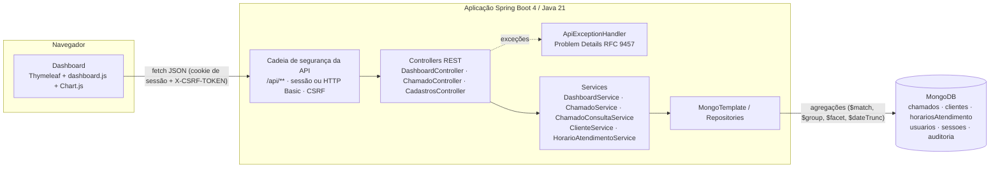

Organização dos pacotes (`br.umc.thindesk`):

| Pacote | Responsabilidade |
|---|---|
| `api` | controllers REST, parâmetros de filtro e tratamento de erros |
| `api.dto` | objetos de entrada e saída da API (records) |
| `dashboard` | cálculo dos indicadores (agregações) e página do dashboard |
| `chamado` | domínio do chamado: entidade, máquina de estados, SLA, serviços, carga de demonstração |
| `cliente`, `horario` | cadastros herdados do Thindesk original |
| `seguranca`, `auth`, `usuario`, `auditoria`, `tema` | herdados do login-seguro-spring |
| `config`, `comum` | relógio/fuso, exceções e utilitários |

## 8. Documentação da API

**URL base:** `http://localhost:8080/api/v1` · **Formato:** JSON (UTF-8) · **Datas:** `inicio`/`fim` em `yyyy-MM-dd` (fuso de São Paulo); instantes nas respostas em ISO-8601 UTC (`2026-11-14T18:00:00Z`).

### 8.1 Autenticação

| Forma | Quando usar | Como |
|---|---|---|
| Sessão do sistema | o próprio dashboard | login em `/login`; o navegador envia o cookie `SESSION`. Requisições que alteram dados enviam o token CSRF no header `X-CSRF-TOKEN`. |
| HTTP Basic | testes com curl/Postman e integração com outros sistemas | header `Authorization: Basic base64(email:senha)`. Dispensa CSRF. |

### 8.2 Parâmetros de filtro (comuns)

Valem para todos os endpoints de `/dashboard/**` e para `GET /chamados`.

| Parâmetro | Tipo | Obrigatório | Padrão | Validação |
|---|---|---|---|---|
| `inicio` | data `yyyy-MM-dd` | não | hoje − 29 dias (dashboard) | formato ISO; `inicio ≤ fim` |
| `fim` | data `yyyy-MM-dd` | não | hoje (dashboard) | período máximo de 366 dias |
| `tipo` | lista de `TipoChamado` | não | todos | `HARDWARE`, `SOFTWARE`, `REDE`, `ACESSO_SENHA`, `EMAIL`, `IMPRESSORA`, `SISTEMA_INTERNO`, `OUTROS` |
| `status` | lista de `StatusChamado` | não | todos | `ABERTO`, `EM_ATENDIMENTO`, `AGUARDANDO_SOLICITANTE`, `RESOLVIDO`, `FECHADO`, `CANCELADO` |
| `prioridade` | lista de `Prioridade` | não | todas | `BAIXA`, `MEDIA`, `ALTA`, `CRITICA` |
| `tecnicoId` | texto | não | — | id de um usuário técnico |
| `setor` | texto | não | — | — |

Listas aceitam valores separados por vírgula (`status=ABERTO,EM_ATENDIMENTO`) ou o parâmetro repetido.

### 8.3 Formato dos erros

Todas as respostas de erro seguem o **Problem Details (RFC 9457)**, com `Content-Type: application/problem+json`:

```json
{
  "type": "/erros/parametro-invalido",
  "title": "Parâmetro inválido",
  "status": 400,
  "detail": "A data de início (2026-11-14) não pode ser posterior à data de fim (2025-01-01).",
  "instance": "/api/v1/dashboard/indicadores",
  "timestamp": "2026-11-14T18:46:02.114Z",
  "erros": [ { "campo": "inicio", "mensagem": "A data de início (2026-11-14) não pode ser posterior à data de fim (2025-01-01)." } ]
}
```

| Status | `type` | Quando acontece |
|---|---|---|
| 400 | `/erros/parametro-invalido` | data em formato errado, período invertido ou maior que 366 dias, enumeração desconhecida, `limite`, `page`, `size` ou `sort` fora do permitido |
| 400 | `/erros/corpo-invalido` | JSON malformado ou valor de enumeração inválido no corpo |
| 401 | `/erros/nao-autenticado` | sem sessão/credenciais ou senha errada (sem `WWW-Authenticate`, para o navegador não abrir janela de senha) |
| 403 | `/erros/acesso-negado` | perfil sem permissão, solicitante acessando chamado de outra pessoa, ou requisição de sessão sem token CSRF |
| 404 | `/erros/nao-encontrado` | chamado inexistente |
| 409 | `/erros/transicao-invalida` | mudança de status não permitida (traz `statusAtual` e `destinosPermitidos`) |
| 422 | `/erros/validacao` | campos do corpo inválidos (traz a lista `erros`) |
| 422 | `/erros/regra-negocio` | regra violada (ex.: sem setor e sem cliente, técnico inválido, consideração em chamado finalizado) |
| 500 | `/erros/erro-interno` | erro inesperado (mensagem genérica, detalhes só no log) |

### 8.4 Endpoints

| # | Método | Caminho | Perfil | Requisito |
|---|---|---|---|---|
| 1 | GET | `/dashboard/indicadores` | ADMINISTRADOR | RF01 |
| 2 | GET | `/dashboard/atendimentos-por-periodo` | ADMINISTRADOR | RF02 |
| 3 | GET | `/dashboard/situacao` | ADMINISTRADOR | RF03 |
| 4 | GET | `/dashboard/tipos-mais-atendidos` | ADMINISTRADOR | RF04 |
| 5 | GET | `/dashboard/ranking-tecnicos` | ADMINISTRADOR | RF04 |
| 6 | GET | `/filtros/opcoes` | ADMINISTRADOR | RF05 |
| 7 | GET | `/chamados` | autenticado | RC03 |
| 8 | GET | `/chamados/{id}` | autenticado | RC03 |
| 9 | POST | `/chamados` | autenticado | RC01 |
| 10 | PATCH | `/chamados/{id}/status` | ADMINISTRADOR, TÉCNICO | RC02 |
| 11 | POST | `/chamados/{id}/consideracoes` | ADMINISTRADOR, TÉCNICO | RC02 |
| 12 | GET | `/clientes` | ADMINISTRADOR, TÉCNICO | RC04 |
| 13 | POST | `/clientes` | ADMINISTRADOR, TÉCNICO | RC04 |
| 14 | GET | `/horarios-atendimento` | ADMINISTRADOR | RC05 |

Os exemplos de resposta abaixo são **respostas reais** da aplicação rodando com os dados de demonstração (coletadas com curl, com a aplicação no ar; arquivos completos em `docs/evidencias/api/`). Listas longas foram encurtadas.

#### 1. `GET /api/v1/dashboard/indicadores` (RF01)

Indicadores gerais do período. **Parâmetros:** filtros comuns (8.2).

```bash
curl -u admin@thindesk.local:SENHA "http://localhost:8080/api/v1/dashboard/indicadores?inicio=2026-10-16&fim=2026-11-14"
```

Resposta `200 OK`:

```json
{
  "inicio": "2026-10-16",
  "fim": "2026-11-14",
  "total": 49,
  "abertos": 0,
  "emAtendimento": 3,
  "aguardandoSolicitante": 0,
  "resolvidos": 3,
  "fechados": 40,
  "cancelados": 3,
  "atrasados": 4,
  "percentualDentroSla": 90.7,
  "tempoMedioPrimeiroAtendimentoHoras": 3.4,
  "tempoMedioResolucaoHoras": 28.4,
  "taxaResolucaoPercentual": 93.5,
  "totalPeriodoAnterior": 52,
  "variacaoTotalPercentual": -5.8,
  "abertosForaDoExpediente": 5
}
```

| Campo | Descrição |
|---|---|
| `abertos`, `emAtendimento`, `aguardandoSolicitante`, `resolvidos`, `fechados`, `cancelados` | quantidade por status |
| `atrasados` | fora do SLA (seção 5.1) |
| `percentualDentroSla`, `taxaResolucaoPercentual` | 0 a 100, uma casa decimal; `null` sem base |
| `tempoMedioPrimeiroAtendimentoHoras`, `tempoMedioResolucaoHoras` | em horas, uma casa decimal |
| `totalPeriodoAnterior`, `variacaoTotalPercentual` | comparação com o período anterior de mesmo tamanho |
| `abertosForaDoExpediente` | abertos fora do horário de atendimento do setor |

**Erros possíveis:** 400 (período inválido, enumeração desconhecida), 401, 403.

**Exemplo de erro 400 (período invertido):**

```json
{
  "detail": "A data de início (2026-11-14) não pode ser posterior à data de fim (2025-01-01).",
  "instance": "/api/v1/dashboard/indicadores",
  "status": 400,
  "title": "Parâmetro inválido",
  "type": "/erros/parametro-invalido",
  "timestamp": "2026-11-14T19:11:19.436495738Z",
  "erros": [
    {
      "mensagem": "A data de início (2026-11-14) não pode ser posterior à data de fim (2025-01-01).",
      "campo": "inicio"
    }
  ]
}
```

#### 2. `GET /api/v1/dashboard/atendimentos-por-periodo` (RF02)

Série temporal de abertos (pela data de abertura) e resolvidos (pela data de resolução).

| Parâmetro adicional | Tipo | Padrão | Valores |
|---|---|---|---|
| `agrupamento` | texto | `DIA` | `DIA`, `SEMANA` (começa na segunda-feira), `MES` |

```bash
curl -u admin@thindesk.local:SENHA "http://localhost:8080/api/v1/dashboard/atendimentos-por-periodo?inicio=2026-10-16&fim=2026-11-14&agrupamento=SEMANA"
```

Resposta `200 OK`:

```json
{
  "inicio": "2026-10-16",
  "fim": "2026-11-14",
  "agrupamento": "SEMANA",
  "pontos": [
    {
      "periodo": "2026-10-12",
      "rotulo": "sem. 12/10",
      "abertos": 0,
      "resolvidos": 1
    },
    {
      "periodo": "2026-10-19",
      "rotulo": "sem. 19/10",
      "abertos": 10,
      "resolvidos": 9
    },
    "... mais 3 itens"
  ]
}
```

**Erros possíveis:** 400 (agrupamento inválido, período inválido), 401, 403.

#### 3. `GET /api/v1/dashboard/situacao` (RF03)

Quantidade e percentual por status e por prioridade (todos os valores aparecem, mesmo com zero).

```json
{
  "total": 49,
  "porStatus": [
    {
      "codigo": "ABERTO",
      "descricao": "Aberto",
      "quantidade": 0,
      "percentual": 0.0
    },
    {
      "codigo": "EM_ATENDIMENTO",
      "descricao": "Em atendimento",
      "quantidade": 3,
      "percentual": 6.1
    },
    "... mais 4 itens"
  ],
  "porPrioridade": [
    {
      "codigo": "BAIXA",
      "descricao": "Baixa",
      "quantidade": 11,
      "percentual": 22.4
    },
    {
      "codigo": "MEDIA",
      "descricao": "Média",
      "quantidade": 29,
      "percentual": 59.2
    },
    "... mais 2 itens"
  ]
}
```

**Erros possíveis:** 400, 401, 403.

**Exemplo de erro 400 (status desconhecido: `?status=PERDIDO`):**

```json
{
  "detail": "Um ou mais parâmetros de consulta são inválidos.",
  "instance": "/api/v1/dashboard/situacao",
  "status": 400,
  "title": "Parâmetro inválido",
  "type": "/erros/parametro-invalido",
  "timestamp": "2026-11-14T19:11:19.714589859Z",
  "erros": [
    {
      "mensagem": "Valor 'PERDIDO' inválido para 'status'.",
      "campo": "status"
    }
  ]
}
```

#### 4. `GET /api/v1/dashboard/tipos-mais-atendidos` (RF04)

| Parâmetro adicional | Tipo | Padrão | Validação |
|---|---|---|---|
| `limite` | inteiro | 5 | 1 a 8 |

```json
[
  {
    "posicao": 1,
    "codigo": "ACESSO_SENHA",
    "descricao": "Acesso e senha",
    "total": 13,
    "atendidos": 12,
    "percentual": 27.9,
    "tempoMedioResolucaoHoras": 22.8
  },
  {
    "posicao": 2,
    "codigo": "SOFTWARE",
    "descricao": "Software",
    "total": 10,
    "atendidos": 8,
    "percentual": 18.6,
    "tempoMedioResolucaoHoras": 21.8
  },
  "... mais 3 itens"
]
```

**Erros possíveis:** 400 (`limite` fora da faixa), 401, 403.

**Exemplo de erro 400 (`limite=50`):**

```json
{
  "detail": "O parâmetro limite deve estar entre 1 e 8.",
  "instance": "/api/v1/dashboard/tipos-mais-atendidos",
  "status": 400,
  "title": "Parâmetro inválido",
  "type": "/erros/parametro-invalido",
  "timestamp": "2026-11-14T19:11:19.985313672Z",
  "erros": [
    {
      "mensagem": "O parâmetro limite deve estar entre 1 e 8.",
      "campo": "limite"
    }
  ]
}
```

#### 5. `GET /api/v1/dashboard/ranking-tecnicos` (RF04)

| Parâmetro adicional | Tipo | Padrão | Validação |
|---|---|---|---|
| `limite` | inteiro | 5 | 1 a 20 |

```json
[
  {
    "posicao": 1,
    "tecnicoId": "6af8b22f27f52910845efee7",
    "nome": "Fernanda Lima",
    "atendidos": 14,
    "emAndamento": 2,
    "tempoMedioResolucaoHoras": 30.1,
    "percentualDentroSla": 92.9
  },
  {
    "posicao": 2,
    "tecnicoId": "6af8b22f27f52910845efee8",
    "nome": "Rafael Souza",
    "atendidos": 10,
    "emAndamento": 0,
    "tempoMedioResolucaoHoras": 27.9,
    "percentualDentroSla": 100.0
  },
  "... mais 3 itens"
]
```

#### 6. `GET /api/v1/filtros/opcoes` (RF05)

Valores para preencher os campos de filtro do painel (técnicos ativos e setores existentes vêm do banco).

```json
{
  "tipos": [
    {
      "codigo": "HARDWARE",
      "descricao": "Hardware"
    },
    {
      "codigo": "SOFTWARE",
      "descricao": "Software"
    },
    "... mais 6 itens"
  ],
  "status": [
    {
      "codigo": "ABERTO",
      "descricao": "Aberto"
    },
    {
      "codigo": "EM_ATENDIMENTO",
      "descricao": "Em atendimento"
    },
    "... mais 4 itens"
  ],
  "prioridades": [
    {
      "codigo": "BAIXA",
      "descricao": "Baixa (SLA 72h)"
    },
    {
      "codigo": "MEDIA",
      "descricao": "Média (SLA 48h)"
    },
    "... mais 2 itens"
  ],
  "tecnicos": [
    {
      "codigo": "6af8b23027f52910845efeea",
      "descricao": "Bruno Oliveira"
    },
    {
      "codigo": "6af8b22f27f52910845efee6",
      "descricao": "Carlos Andrade"
    },
    "... mais 3 itens"
  ],
  "setores": [
    "Atendimento",
    "Comercial",
    "... mais 4 itens"
  ],
  "agrupamentos": [
    {
      "codigo": "DIA",
      "descricao": "Dia"
    },
    {
      "codigo": "SEMANA",
      "descricao": "Semana"
    },
    {
      "codigo": "MES",
      "descricao": "Mês"
    }
  ]
}
```

#### 7. `GET /api/v1/chamados`

Listagem paginada. O SOLICITANTE só recebe os próprios chamados.

| Parâmetro adicional | Tipo | Padrão | Validação |
|---|---|---|---|
| `busca` | texto | — | procura no protocolo e no título (sem diferenciar maiúsculas) |
| `page` | inteiro | 0 | ≥ 0 |
| `size` | inteiro | 10 | 1 a 100 |
| `sort` | `campo,asc\|desc` | `dataAbertura,desc` | campos: `dataAbertura`, `protocolo`, `prazoSla`, `dataResolucao`, `status`, `prioridade`, `tipo` |

Aqui o período é opcional (sem `inicio`/`fim`, lista de qualquer data).

```bash
curl -u admin@thindesk.local:SENHA "http://localhost:8080/api/v1/chamados?page=0&size=3&sort=dataAbertura,desc"
```

```json
{
  "conteudo": [
    {
      "id": "6af8b23027f52910845f00c1",
      "protocolo": "TD-2026-000380",
      "titulo": "Programa fechando sozinho",
      "tipo": "SOFTWARE",
      "tipoDescricao": "Software",
      "prioridade": "MEDIA",
      "prioridadeDescricao": "Média",
      "status": "RESOLVIDO",
      "statusDescricao": "Resolvido",
      "setor": "Financeiro",
      "solicitante": "Renata Carvalho",
      "tecnico": "Bruno Oliveira",
      "dataAbertura": "2026-11-13T20:52:00Z",
      "prazoSla": "2026-11-15T20:52:00Z",
      "dataResolucao": "2026-11-14T06:51:42Z",
      "atrasado": false
    },
    {
      "id": "6af8b23027f52910845f00c0",
      "protocolo": "TD-2026-000379",
      "titulo": "Mouse sem resposta",
      "tipo": "HARDWARE",
      "tipoDescricao": "Hardware",
      "prioridade": "MEDIA",
      "prioridadeDescricao": "Média",
      "status": "EM_ATENDIMENTO",
      "statusDescricao": "Em atendimento",
      "setor": "Jurídico",
      "solicitante": "Camila Rocha",
      "tecnico": "Carlos Andrade",
      "dataAbertura": "2026-11-13T19:55:00Z",
      "prazoSla": "2026-11-15T19:55:00Z",
      "dataResolucao": null,
      "atrasado": false
    },
    {
      "id": "6af8b23027f52910845f00bf",
      "protocolo": "TD-2026-000378",
      "titulo": "Acesso negado ao sistema",
      "tipo": "ACESSO_SENHA",
      "tipoDescricao": "Acesso e senha",
      "prioridade": "CRITICA",
      "prioridadeDescricao": "Crítica",
      "status": "FECHADO",
      "statusDescricao": "Fechado",
      "setor": "Operações",
      "solicitante": "Rodrigo Mendes",
      "tecnico": "Rafael Souza",
      "dataAbertura": "2026-11-13T18:25:00Z",
      "prazoSla": "2026-11-14T02:25:00Z",
      "dataResolucao": "2026-11-13T21:46:26Z",
      "atrasado": false
    }
  ],
  "pagina": 0,
  "tamanho": 3,
  "totalElementos": 420,
  "totalPaginas": 140
}
```

**Erros possíveis:** 400 (`page`, `size`, `sort` inválidos ou filtros inválidos), 401.

**Exemplo de erro 400 (`sort=senha,asc`):**

```json
{
  "detail": "Ordenação por 'senha' não é permitida. Use um de: dataAbertura, dataResolucao, prazoSla, prioridade, protocolo, status, tipo.",
  "instance": "/api/v1/chamados",
  "status": 400,
  "title": "Parâmetro inválido",
  "type": "/erros/parametro-invalido",
  "timestamp": "2026-11-14T19:11:20.256920502Z",
  "erros": [
    {
      "mensagem": "Ordenação por 'senha' não é permitida. Use um de: dataAbertura, dataResolucao, prazoSla, prioridade, protocolo, status, tipo.",
      "campo": "sort"
    }
  ]
}
```

#### 8. `GET /api/v1/chamados/{id}`

Detalhe completo, com considerações, histórico e os próximos status permitidos.

```json
{
  "id": "6af8b23027f52910845f00c1",
  "protocolo": "TD-2026-000380",
  "titulo": "Programa fechando sozinho",
  "descricao": "Chamado aberto por Renata Carvalho: programa fechando sozinho.",
  "tipo": "SOFTWARE",
  "tipoDescricao": "Software",
  "prioridade": "MEDIA",
  "prioridadeDescricao": "Média",
  "slaHoras": 48,
  "status": "RESOLVIDO",
  "statusDescricao": "Resolvido",
  "setor": "Financeiro",
  "solicitante": {
    "usuarioId": "6af8b23027f52910845eff16",
    "nome": "Renata Carvalho"
  },
  "tecnico": {
    "usuarioId": "6af8b23027f52910845efeea",
    "nome": "Bruno Oliveira"
  },
  "dataAbertura": "2026-11-13T20:52:00Z",
  "dataInicioAtendimento": "2026-11-13T22:12:22Z",
  "dataResolucao": "2026-11-14T06:51:42Z",
  "dataFechamento": null,
  "prazoSla": "2026-11-15T20:52:00Z",
  "atrasado": false,
  "proximosStatusPermitidos": [
    "EM_ATENDIMENTO",
    "FECHADO"
  ],
  "consideracoes": [
    {
      "texto": "Licença renovada no portal do fabricante.",
      "autor": "Bruno Oliveira",
      "data": "2026-11-14T06:51:42Z"
    }
  ],
  "historico": [
    {
      "de": null,
      "para": "ABERTO",
      "usuario": "Renata Carvalho",
      "data": "2026-11-13T20:52:00Z"
    },
    {
      "de": "ABERTO",
      "para": "EM_ATENDIMENTO",
      "usuario": "Bruno Oliveira",
      "data": "2026-11-13T22:12:22Z"
    },
    {
      "de": "EM_ATENDIMENTO",
      "para": "RESOLVIDO",
      "usuario": "Bruno Oliveira",
      "data": "2026-11-14T06:51:42Z"
    }
  ]
}
```

**Erros possíveis:** 401, 403 (solicitante tentando ver chamado de outra pessoa), 404.

**Exemplo de erro 404:**

```json
{
  "detail": "Chamado 000000000000000000000000 não encontrado.",
  "instance": "/api/v1/chamados/000000000000000000000000",
  "status": 404,
  "title": "Recurso não encontrado",
  "type": "/erros/nao-encontrado",
  "timestamp": "2026-11-14T19:11:21.079199009Z"
}
```

#### 9. `POST /api/v1/chamados`

Abre um chamado com status `ABERTO`, protocolo e prazo calculados. Retorna `201 Created` com o header `Location`.

| Campo do corpo | Tipo | Obrigatório | Validação |
|---|---|---|---|
| `titulo` | texto | sim | 5 a 120 caracteres |
| `descricao` | texto | sim | até 2000 caracteres |
| `tipo` | `TipoChamado` | sim | enumeração |
| `prioridade` | `Prioridade` | sim | enumeração |
| `setor` | texto | se não houver `clienteId` | até 60 caracteres |
| `clienteId` | texto | não | ADMINISTRADOR/TÉCNICO abrindo em nome de um cliente: o setor passa a ser o do cliente |

```bash
curl -u admin@thindesk.local:SENHA -H "Content-Type: application/json" -X POST http://localhost:8080/api/v1/chamados \
  -d '{"titulo":"Impressora do 2o andar sem toner","descricao":"A impressora da sala de reunioes nao imprime.","tipo":"IMPRESSORA","prioridade":"MEDIA","setor":"Comercial"}'
```

**Resposta `201 Created`:**

```json
{
  "id": "6af8b25627f52910845f00c5",
  "protocolo": "TD-2026-000381",
  "titulo": "Impressora do 2o andar sem toner",
  "descricao": "A impressora da sala de reunioes nao imprime.",
  "tipo": "IMPRESSORA",
  "tipoDescricao": "Impressora",
  "prioridade": "MEDIA",
  "prioridadeDescricao": "Média",
  "slaHoras": 48,
  "status": "ABERTO",
  "statusDescricao": "Aberto",
  "setor": "Comercial",
  "solicitante": {
    "usuarioId": "6af8b23027f52910845f00c2",
    "nome": "Administrador Thindesk"
  },
  "tecnico": null,
  "dataAbertura": "2026-11-14T19:11:18.265348216Z",
  "dataInicioAtendimento": null,
  "dataResolucao": null,
  "dataFechamento": null,
  "prazoSla": "2026-11-16T19:11:18.265348216Z",
  "atrasado": false,
  "proximosStatusPermitidos": [
    "EM_ATENDIMENTO",
    "CANCELADO"
  ],
  "consideracoes": [],
  "historico": [
    {
      "de": null,
      "para": "ABERTO",
      "usuario": "Administrador Thindesk",
      "data": "2026-11-14T19:11:18.265348216Z"
    }
  ]
}
```

**Erros possíveis:** 400 (JSON malformado), 401, 403 (sem CSRF na sessão ou solicitante usando `clienteId`), 422 (validação ou falta de setor/cliente).

**Exemplo de erro 422 (validação):**

```json
{
  "detail": "Um ou mais campos do corpo da requisição são inválidos.",
  "instance": "/api/v1/chamados",
  "status": 422,
  "title": "Dados inválidos",
  "type": "/erros/validacao",
  "timestamp": "2026-11-14T19:11:21.622717049Z",
  "erros": [
    {
      "mensagem": "O título deve ter entre 5 e 120 caracteres.",
      "campo": "titulo"
    },
    {
      "mensagem": "Descreva o problema.",
      "campo": "descricao"
    },
    {
      "mensagem": "Informe o tipo.",
      "campo": "tipo"
    }
  ]
}
```

**Exemplo de erro 400 (JSON malformado):**

```json
{
  "detail": "O JSON enviado está malformado ou contém um valor inválido (verifique os campos de enumeração).",
  "instance": "/api/v1/chamados",
  "status": 400,
  "title": "Corpo da requisição inválido",
  "type": "/erros/corpo-invalido",
  "timestamp": "2026-11-14T19:11:21.892200948Z"
}
```

#### 10. `PATCH /api/v1/chamados/{id}/status`

| Campo do corpo | Tipo | Obrigatório | Descrição |
|---|---|---|---|
| `status` | `StatusChamado` | sim | novo status (precisa ser permitido pela máquina de estados) |
| `tecnicoId` | texto | não | atribui ou troca o técnico responsável |
| `comentario` | texto | não | até 1000 caracteres; vira consideração técnica |

```bash
curl -u admin@thindesk.local:SENHA -H "Content-Type: application/json" -X PATCH \
  http://localhost:8080/api/v1/chamados/{id}/status -d '{"status":"EM_ATENDIMENTO","tecnicoId":"{idDoTecnico}"}'
```

**Resposta `200 OK` (resumida):**

```json
{
  "id": "6af8b25627f52910845f00c5",
  "protocolo": "TD-2026-000381",
  "titulo": "Impressora do 2o andar sem toner",
  "descricao": "A impressora da sala de reunioes nao imprime.",
  "tipo": "IMPRESSORA",
  "tipoDescricao": "Impressora",
  "prioridade": "MEDIA",
  "prioridadeDescricao": "Média",
  "slaHoras": 48,
  "status": "EM_ATENDIMENTO",
  "statusDescricao": "Em atendimento",
  "setor": "Comercial",
  "solicitante": {
    "usuarioId": "6af8b23027f52910845f00c2",
    "nome": "Administrador Thindesk"
  },
  "tecnico": {
    "usuarioId": "6af8b23027f52910845efeea",
    "nome": "Bruno Oliveira"
  },
  "dataAbertura": "2026-11-14T19:11:18.265Z",
  "dataInicioAtendimento": "2026-11-14T19:11:18.594675842Z",
  "dataResolucao": null,
  "dataFechamento": null,
  "prazoSla": "2026-11-16T19:11:18.265Z",
  "atrasado": false,
  "proximosStatusPermitidos": [
    "AGUARDANDO_SOLICITANTE",
    "RESOLVIDO",
    "CANCELADO"
  ],
  "consideracoes": [],
  "historico": [
    {
      "de": null,
      "para": "ABERTO",
      "usuario": "Administrador Thindesk",
      "data": "2026-11-14T19:11:18.265Z"
    },
    {
      "de": "ABERTO",
      "para": "EM_ATENDIMENTO",
      "usuario": "Administrador Thindesk",
      "data": "2026-11-14T19:11:18.594675842Z"
    }
  ]
}
```

**Erros possíveis:** 400, 401, 403 (perfil SOLICITANTE), 404, 409 (transição inválida), 422 (técnico inválido ou ausente).

**Exemplo de erro 409 (EM_ATENDIMENTO → ABERTO):**

```json
{
  "detail": "Não é possível mudar o chamado de RESOLVIDO para ABERTO. Destinos permitidos a partir de RESOLVIDO: [EM_ATENDIMENTO, FECHADO].",
  "instance": "/api/v1/chamados/6af8b25627f52910845f00c5/status",
  "status": 409,
  "title": "Transição de status inválida",
  "type": "/erros/transicao-invalida",
  "timestamp": "2026-11-14T19:11:21.350843941Z",
  "statusAtual": "RESOLVIDO",
  "destinosPermitidos": [
    "EM_ATENDIMENTO",
    "FECHADO"
  ]
}
```

#### 11. `POST /api/v1/chamados/{id}/consideracoes`

| Campo do corpo | Tipo | Obrigatório | Validação |
|---|---|---|---|
| `texto` | texto | sim | até 1000 caracteres |

Retorna `201 Created` com o chamado atualizado. **Erros possíveis:** 401, 403, 404, 422 (chamado fechado/cancelado ou texto vazio).

#### 12. `GET /api/v1/clientes`

| Parâmetro | Tipo | Obrigatório | Descrição |
|---|---|---|---|
| `setor` | texto | não | filtra por setor |

```json
[
  {
    "id": "6af8b23027f52910845eff0a",
    "nome": "Ana Paula Ribeiro",
    "telefone": "(11) 91000-2000",
    "setor": "Financeiro",
    "email": null
  },
  {
    "id": "6af8b23027f52910845eff10",
    "nome": "Beatriz Almeida",
    "telefone": "(11) 91222-2318",
    "setor": "Financeiro",
    "email": null
  },
  "... mais 2 itens"
]
```

#### 13. `POST /api/v1/clientes`

| Campo do corpo | Tipo | Obrigatório | Validação |
|---|---|---|---|
| `nome` | texto | sim | 3 a 100 caracteres |
| `telefone` | texto | não | com DDD, ex.: `(11) 98765-4321` |
| `setor` | texto | sim | até 60 caracteres |
| `email` | texto | não | e-mail válido |

**Resposta `201 Created`:**

```json
{
  "id": "6af8b25527f52910845f00c4",
  "nome": "Marina Prado",
  "telefone": "(11) 91234-5678",
  "setor": "Juridico",
  "email": "marina@empresa.com"
}
```

**Erros possíveis:** 400, 401, 403 (SOLICITANTE), 422.

#### 14. `GET /api/v1/horarios-atendimento`

| Parâmetro | Tipo | Obrigatório | Descrição |
|---|---|---|---|
| `setor` | texto | não | filtra por setor |

```json
[
  {
    "id": "6af8b23027f52910845eff04",
    "setor": "Atendimento",
    "diaSemana": "MONDAY",
    "horarioInicio": "08:00",
    "horarioFim": "18:00"
  },
  {
    "id": "6af8b23027f52910845eff05",
    "setor": "Atendimento",
    "diaSemana": "TUESDAY",
    "horarioInicio": "08:00",
    "horarioFim": "18:00"
  },
  "... mais 4 itens"
]
```

**Erros possíveis:** 401, 403 (TÉCNICO e SOLICITANTE).

#### Exemplos de 401 e 403

**401 sem credenciais:**

```json
{
  "type": "/erros/nao-autenticado",
  "title": "Não autenticado",
  "status": 401,
  "detail": "Faça login (sessão do sistema ou HTTP Basic) para acessar a API.",
  "instance": "/api/v1/dashboard/indicadores",
  "timestamp": "2026-11-14T19:11:20.266652774Z"
}
```

**403 técnico acessando o dashboard:**

```json
{
  "type": "/erros/acesso-negado",
  "title": "Acesso negado",
  "status": 403,
  "detail": "Seu perfil não tem permissão para este recurso.",
  "instance": "/api/v1/dashboard/indicadores",
  "timestamp": "2026-11-14T19:11:20.805445076Z"
}
```

O arquivo [`docs/requisicoes.http`](requisicoes.http) traz todas as chamadas prontas para o REST Client (VS Code) ou o HTTP Client do IntelliJ.

## 9. Dashboard administrativo

Acesso: entrar com um usuário ADMINISTRADOR e abrir **Dashboard** no menu lateral (`/admin/dashboard`).

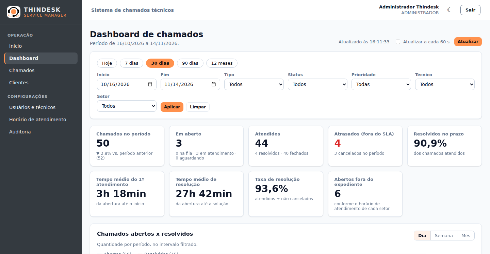
*Indicadores gerais (RF01) e filtros (RF05)*

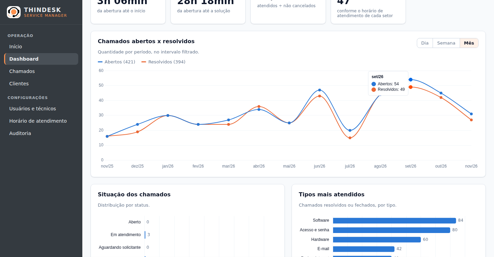
*Abertos x resolvidos nos últimos 12 meses, agrupado por mês (RF02)*

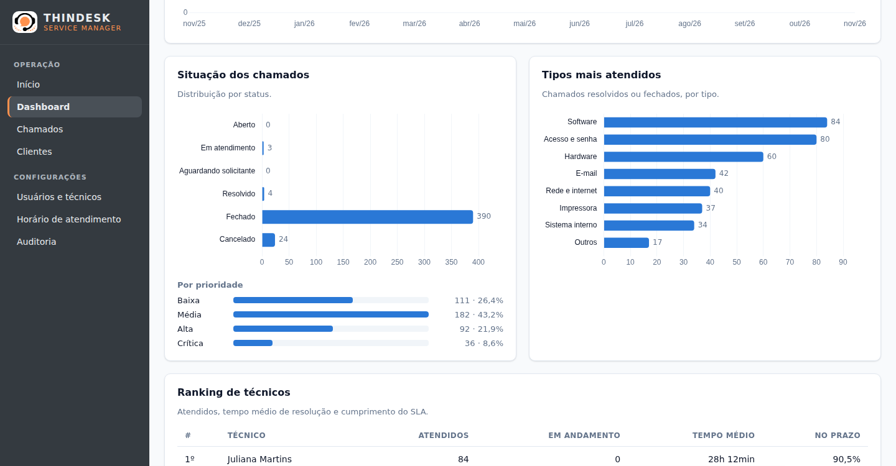
*Situação por status e prioridade (RF03), tipos mais atendidos (RF04) e ranking de técnicos*

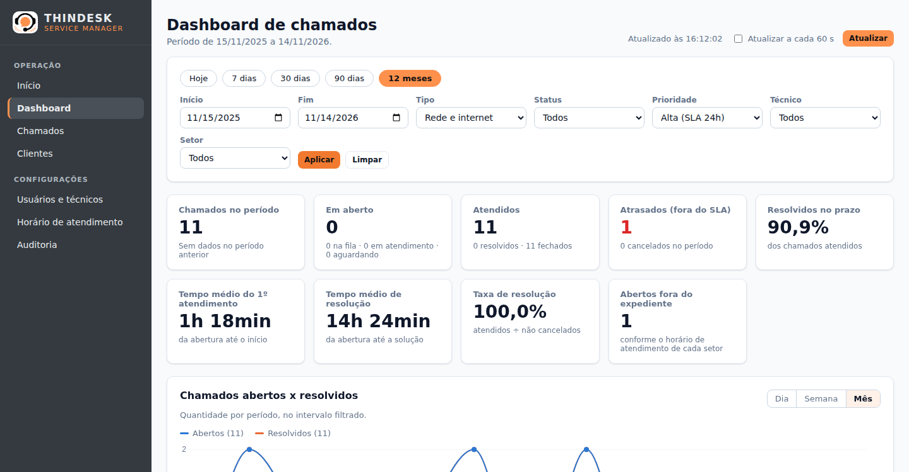
*Filtros combinados: tipo Rede + prioridade Alta (RF05)*

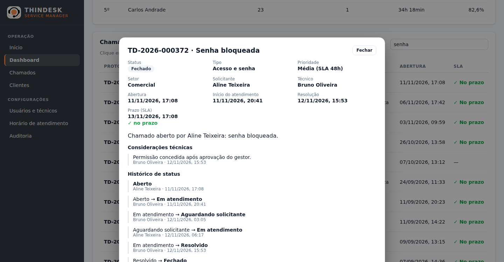
*Detalhe do chamado com considerações técnicas e histórico*

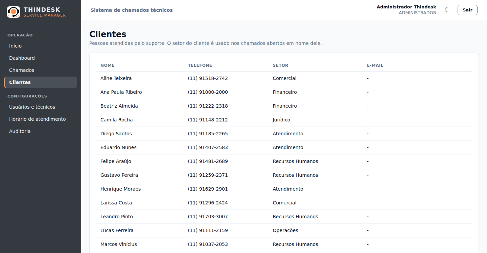
*Clientes (cadastro herdado do Thindesk)*

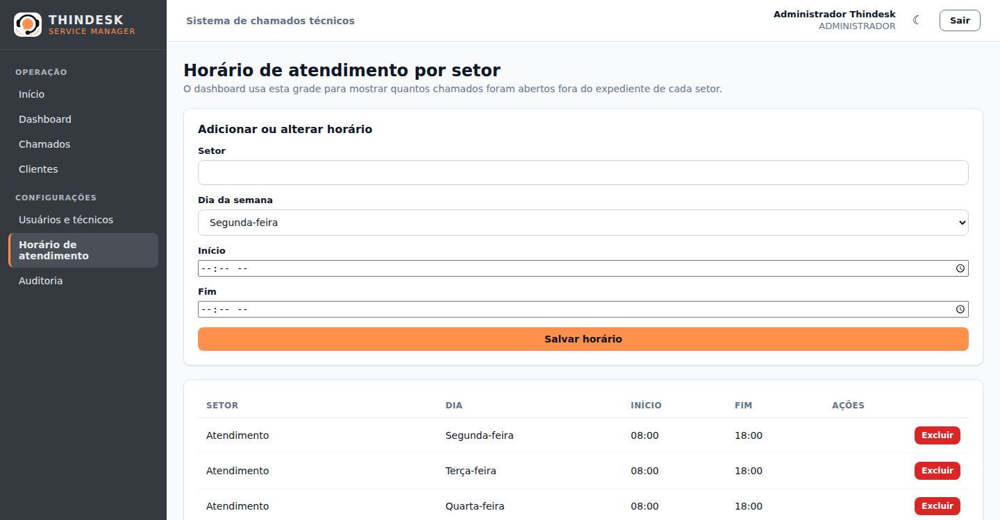
*Horário de atendimento por setor (configuração herdada do Thindesk)*

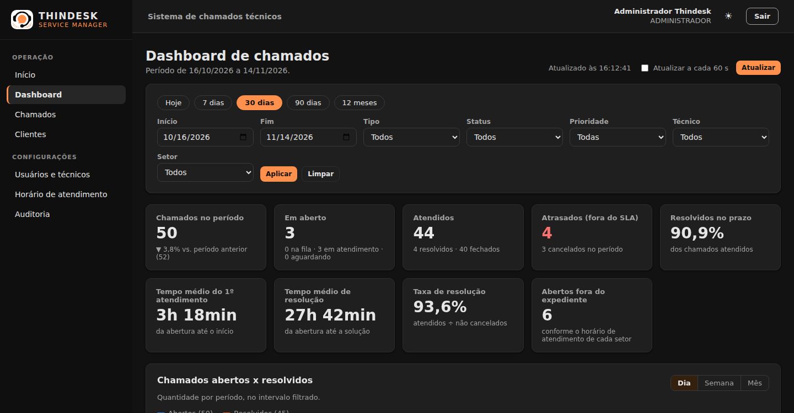
*Tema escuro*

Comportamentos de RF06 e RF07:

- A página só entrega a estrutura; o `dashboard.js` chama 6 endpoints em paralelo e preenche cada bloco quando a sua resposta chega.
- **Atualizar** recarrega tudo; **Atualizar a cada 60 s** liga a atualização automática (a preferência fica salva no navegador).
- Cada bloco tem os estados *carregando*, *vazio* ("Nenhum chamado encontrado…") e *erro* (mensagem da API + botão "Tentar de novo"). Se a sessão expirar, o bloco mostra "Entrar novamente".
- Os filtros são validados antes da chamada (datas obrigatórias, início ≤ fim, até 366 dias). Erros 400 da API aparecem embaixo do formulário.
- A busca na lista de chamados espera 400 ms depois da última tecla (*debounce*) para não chamar a API a cada letra.

## 10. Evidências de testes

### 10.1 Testes automatizados

Executados com `./mvnw verify`, com um MongoDB 7 para os testes de integração.

| Grupo de testes | Testes | Falhas | Erros | Tempo |
|---|---|---|---|---|
| br.umc.thindesk.ThindeskApplicationTests | 1 | 0 | 0 | 6.692 s |
| Filtro do dashboard | 8 | 0 | 0 | 0.156 s |
| Cálculos auxiliares do dashboard | 4 | 0 | 0 | 1.363 s |
| Horário de atendimento | 5 | 0 | 0 | 0.208 s |
| Carga de dados de demonstração | 3 | 0 | 0 | 0.616 s |
| Ciclo de vida do chamado | 11 | 0 | 0 | 0.190 s |
| Listagem de chamados | 5 | 0 | 0 | 0.036 s |
| Máquina de estados do chamado | 18 | 0 | 0 | 0.193 s |
| Regra de SLA | 6 | 0 | 0 | 0.019 s |
| Segurança | 7 | 0 | 0 | 1.808 s |
| Dashboard | 6 | 0 | 0 | 0.363 s |
| Chamados | 10 | 0 | 0 | 0.723 s |
| Integração API + MongoDB | 11 | 0 | 0 | 19.67 s |
| **Total** | **95** | **0** | **0** | |

Resultado do build: **BUILD SUCCESS** (resumo em `docs/evidencias/testes/resumo-testes.txt` e relatórios por classe em `docs/evidencias/testes/surefire/`).

| Classe | Tipo | O que cobre |
|---|---|---|
| `StatusChamadoTest` | unitário | todas as transições permitidas e bloqueadas da máquina de estados |
| `RegraSlaTest` | unitário | cálculo do prazo e regra de atraso (aberto, resolvido no prazo/fora, cancelado) |
| `FiltroChamadosTest` | unitário | período padrão, validação de datas, fuso de São Paulo e montagem do `$match` |
| `DashboardServiceTest` | unitário | agrupamento por dia/semana/mês, rótulos e validação de `limite` |
| `ChamadoServiceTest` | unitário (Mockito) | abertura, atribuição de técnico, datas do ciclo de vida, reabertura, 404, 409 e 422 |
| `ChamadoConsultaServiceTest` | unitário | paginação, ordenação permitida e busca tratada como texto literal |
| `CargaInicialChamadosTest` | unitário | coerência dos dados de demonstração com a máquina de estados |
| `HorarioAtendimentoServiceTest` | unitário | dentro/fora do expediente e substituição de horário |
| `ApiControllerTest` | controller (`@WebMvcTest`) | 401/403 em JSON, CSRF, permissões por perfil, 400/404/409/422 no formato Problem Details |
| `ApiIntegracaoTest` | integração (MongoDB real) | números exatos das agregações, série temporal, filtros, paginação, clientes, horários, ciclo de vida completo pela API |
| `ThindeskApplicationTests` | integração | a aplicação sobe com todas as configurações |

**Cobertura de código (JaCoCo):**

| Pacote | Linhas | Desvios (if/else) |
|---|---|---|
| `br.umc.thindesk` | 20.0% | — |
| `br.umc.thindesk.api` | 85.1% | 64.3% |
| `br.umc.thindesk.api.dto` | 100.0% | 70.0% |
| `br.umc.thindesk.auditoria` | 78.4% | — |
| `br.umc.thindesk.auth` | 18.2% | 4.2% |
| `br.umc.thindesk.chamado` | 81.5% | 66.9% |
| `br.umc.thindesk.cliente` | 78.7% | 41.7% |
| `br.umc.thindesk.comum` | 56.5% | 0.0% |
| `br.umc.thindesk.config` | 70.6% | 0.0% |
| `br.umc.thindesk.dashboard` | 97.6% | 79.6% |
| `br.umc.thindesk.horario` | 77.0% | 63.6% |
| `br.umc.thindesk.seguranca` | 64.8% | 31.5% |
| `br.umc.thindesk.tema` | 40.9% | 7.1% |
| `br.umc.thindesk.usuario` | 31.8% | 4.2% |
| **Total** | **73.0%** | **54.7%** |

### 10.2 Casos de teste da API (aplicação rodando)

Executados com curl e HTTP Basic (as mesmas chamadas de `docs/requisicoes.http`) contra a aplicação no ar, com MongoDB e dados de demonstração. As respostas completas estão em `docs/evidencias/api/`.

| ID | Cenário | Requisição | Esperado | Obtido | Resultado |
|---|---|---|---|---|---|
| API01 | Indicadores dos últimos 30 dias | `GET /api/v1/dashboard/indicadores?inicio=2026-10-16&fim=2026-11-14` | 200 | 200 | ✔ passou |
| API02 | Série semanal de abertos x resolvidos | `GET /api/v1/dashboard/atendimentos-por-periodo?inicio=2026-10-16&fim=2026-11-14&agrupamento=SEMANA` | 200 | 200 | ✔ passou |
| API03 | Situação por status e prioridade | `GET /api/v1/dashboard/situacao?inicio=2026-10-16&fim=2026-11-14` | 200 | 200 | ✔ passou |
| API04 | Top 5 tipos mais atendidos | `GET /api/v1/dashboard/tipos-mais-atendidos?inicio=2026-10-16&fim=2026-11-14&limite=5` | 200 | 200 | ✔ passou |
| API05 | Top 5 técnicos | `GET /api/v1/dashboard/ranking-tecnicos?inicio=2026-10-16&fim=2026-11-14&limite=5` | 200 | 200 | ✔ passou |
| API06 | Opções de filtro | `GET /api/v1/filtros/opcoes` | 200 | 200 | ✔ passou |
| API07 | Indicadores com tipo e prioridade filtrados | `GET /api/v1/dashboard/indicadores?inicio=2026-10-16&fim=2026-11-14&tipo=REDE,SOFTWARE&prioridade=ALTA` | 200 | 200 | ✔ passou |
| API08 | Listagem paginada | `GET /api/v1/chamados?page=0&size=3&sort=dataAbertura,desc` | 200 | 200 | ✔ passou |
| API09 | Busca por texto | `GET /api/v1/chamados?busca=senha&size=2` | 200 | 200 | ✔ passou |
| API10 | Detalhe de chamado | `GET /api/v1/chamados/{id}` | 200 | 200 | ✔ passou |
| API11 | Abertura de chamado | `POST /api/v1/chamados` | 201 | 201 | ✔ passou |
| API12 | Início do atendimento com técnico | `PATCH /api/v1/chamados/{id}/status` | 200 | 200 | ✔ passou |
| API13 | Consideração técnica | `POST /api/v1/chamados/{id}/consideracoes` | 201 | 201 | ✔ passou |
| API14 | Resolução do chamado | `PATCH /api/v1/chamados/{id}/status` | 200 | 200 | ✔ passou |
| API15 | Clientes de um setor | `GET /api/v1/clientes?setor=Financeiro` | 200 | 200 | ✔ passou |
| API16 | Cadastro de cliente pelo técnico | `POST /api/v1/clientes` | 201 | 201 | ✔ passou |
| API17 | Horários de atendimento de um setor | `GET /api/v1/horarios-atendimento?setor=Atendimento` | 200 | 200 | ✔ passou |
| API20 | Período invertido | `GET /api/v1/dashboard/indicadores?inicio=2026-11-14&fim=2025-01-01` | 400 | 400 | ✔ passou |
| API21 | Status desconhecido | `GET /api/v1/dashboard/situacao?status=PERDIDO` | 400 | 400 | ✔ passou |
| API22 | Limite fora da faixa | `GET /api/v1/dashboard/tipos-mais-atendidos?limite=50` | 400 | 400 | ✔ passou |
| API23 | Ordenação por campo não permitido | `GET /api/v1/chamados?sort=senha,asc` | 400 | 400 | ✔ passou |
| API24 | Sem credenciais | `GET /api/v1/dashboard/indicadores` | 401 | 401 | ✔ passou |
| API25 | Senha errada | `GET /api/v1/dashboard/indicadores` | 401 | 401 | ✔ passou |
| API26 | Técnico acessando o dashboard | `GET /api/v1/dashboard/indicadores` | 403 | 403 | ✔ passou |
| API27 | Chamado inexistente | `GET /api/v1/chamados/{id}` | 404 | 404 | ✔ passou |
| API28 | Transição de status inválida | `PATCH /api/v1/chamados/{id}/status` | 409 | 409 | ✔ passou |
| API29 | Corpo com campos inválidos | `POST /api/v1/chamados` | 422 | 422 | ✔ passou |
| API30 | JSON malformado | `POST /api/v1/chamados` | 400 | 400 | ✔ passou |
| API31 | Chamado sem setor e sem cliente | `POST /api/v1/chamados` | 422 | 422 | ✔ passou |
| API32 | Técnico acessando horários de atendimento | `GET /api/v1/horarios-atendimento` | 403 | 403 | ✔ passou |

### 10.3 Testes da interface

Testes feitos no navegador, usando o sistema como o responsável pelos chamados: login, filtros, troca de agrupamento, busca, detalhe do chamado, atualização automática, tema escuro e o acesso negado ao perfil técnico. Os prints estão em `docs/evidencias/prints/`.

| ID | Cenário | Resultado esperado | Evidência |
|---|---|---|---|
| UI01 | Login de ADMINISTRADOR | redireciona para o dashboard | `01-login.png`, `02-dashboard-indicadores.png` |
| UI02 | Atalho "12 meses" | gráfico muda para agrupamento mensal | `03-grafico-atendimentos-12-meses.png` |
| UI03 | Filtro tipo Rede + prioridade Alta | todos os blocos refletem o filtro | `05-filtros-rede-alta.png` |
| UI04 | Busca "senha" na lista | só chamados com "senha" no título | `06-lista-chamados-busca.png` |
| UI05 | Clique em um chamado | modal com considerações e histórico | `07-detalhe-chamado.png` |
| UI06 | Tema escuro | gráficos e cartões legíveis no tema escuro | `08-dashboard-tema-escuro.png` |
| UI07 | Técnico acessa a API do dashboard | 403 em JSON | `14-api-erro-403.png` |

## 11. Principais decisões de projeto

1. **Integrar em vez de reescrever o Thindesk.** O dashboard usa as mesmas coleções (`chamados`, `clientes`, `horariosAtendimento`) e a mesma identidade visual do sistema original. O chamado foi enriquecido (enumerações, datas, SLA) porque indicadores confiáveis exigem dados estruturados: com status em texto livre ("Aberto", "aberto", "ABERTO") não dá para contar com segurança.
2. **Indicadores calculados no banco.** Agregações do MongoDB devolvem só os totais, então o volume trafegado não cresce com o número de chamados. O agrupamento por período usa `$dateTrunc` com fuso, o que evita o erro clássico de um chamado aberto às 22h aparecer no dia seguinte (UTC).
3. **Documento único para o chamado.** Considerações e histórico embutidos permitem ler o detalhe em uma consulta e calcular tudo sem `$lookup`.
4. **API REST versionada e com DTOs.** `/api/v1` permite evoluir sem quebrar clientes, e os DTOs evitam expor campos internos (por exemplo, o hash de senha do usuário).
5. **Erros padronizados (RFC 9457).** Um único formato para todos os erros simplifica o tratamento no front-end, que mostra o `detail` da API direto para o usuário.
6. **Segurança própria para a API.** Uma cadeia separada responde 401/403 em JSON (em vez de redirecionar para o login), aceita a sessão do dashboard com CSRF e também HTTP Basic para integração.
7. **Front-end sem framework pesado.** Thymeleaf + JavaScript puro + Chart.js servido localmente. Menos dependências, sem etapa de build e sem depender de CDN no dia da apresentação.
8. **Relógio injetável (`Clock`).** As regras de SLA e de período são testáveis com data fixa.
9. **Dados de demonstração reproduzíveis.** A semente fixa do gerador cria 12 meses de histórico realista (incluindo atrasos e chamados fora do expediente), para o painel ter o que mostrar e os testes serem estáveis.

## 12. Gitflow e organização do repositório

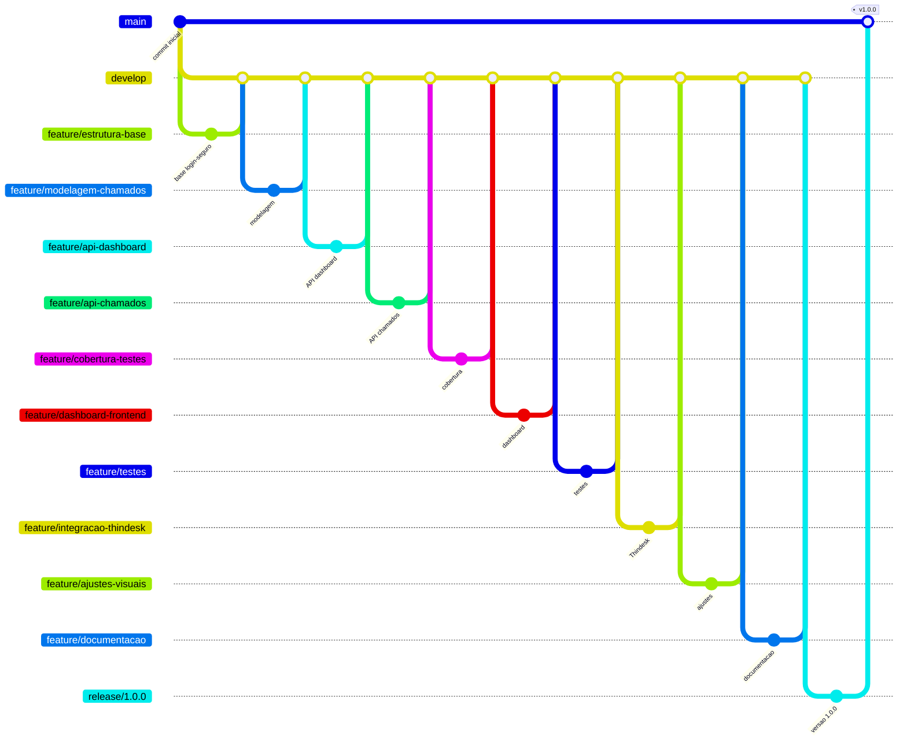

| Branch | Papel |
|---|---|
| `main` | versão entregue (tag `v1.0.0`) |
| `develop` | integração das funcionalidades |
| `feature/*` | uma branch por etapa, integrada na `develop` com merge `--no-ff` |
| `release/1.0.0` | preparação da versão (changelog e versão) antes de ir para a `main` |

Estrutura de pastas:

```
├── docs/                  documentação, requisições de exemplo, evidências e vídeo
└── src/
    ├── main/java/br/umc/thindesk/   código da aplicação (pacotes na seção 7)
    ├── main/resources/              templates Thymeleaf, CSS, JS e configuração
    └── test/java/br/umc/thindesk/   testes automatizados
```

## 13. Como executar

**Pré-requisitos:** Java 21 e um MongoDB (Atlas gratuito ou local).

1. Copie `.env.example` para `.env` e preencha pelo menos `MONGODB_URI`, `ADMIN_NOME`, `ADMIN_EMAIL` e `ADMIN_SENHA` (tire o `#` do começo das linhas).
2. Para ter dados de demonstração, coloque também `THINDESK_SEED=true` (e, se quiser entrar como técnico, `DEMO_SENHA`).
3. Rode `./mvnw spring-boot:run` (Linux/Mac) ou `.\mvnw.cmd spring-boot:run` (Windows).
4. Acesse `http://localhost:8080`, entre com o administrador e abra **Dashboard**.

Testes: `./mvnw verify` (os testes de integração rodam quando `MONGODB_URI` está definida). Relatório de cobertura em `target/site/jacoco/index.html`.
